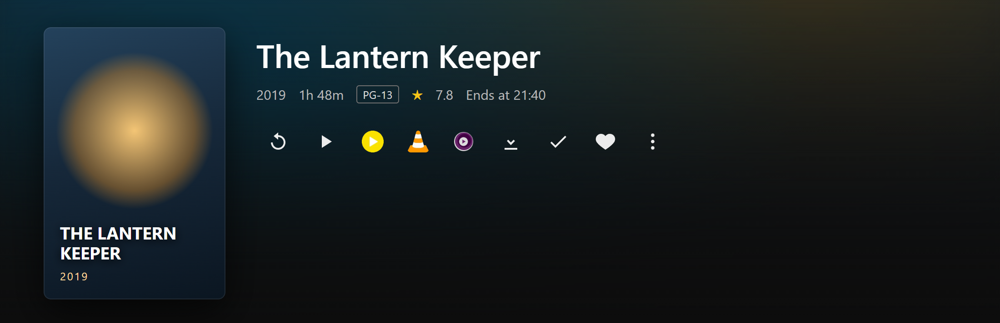
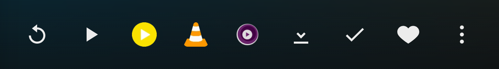

# Jellyfin External Player

A userscript that adds **external player buttons** to the Jellyfin item detail page.
Press a button, your own player opens the original file — no transcoding, no re-encoding,
no lost HDR or surround audio.

Works with **PotPlayer, VLC, IINA, nPlayer, Infuse, MX Player and mpv**, and only shows the
players that actually exist on the current platform (Windows / macOS / iOS / Android).



<sub>Windows: PotPlayer · VLC · mpv appear right after the native Play button.<br>
Screenshots use mock data — see [tools/mock-harness.html](tools/mock-harness.html).</sub>



On macOS the same row becomes VLC · IINA · nPlayer · Infuse · mpv:


---

## Features

- **Native placement** — buttons join the existing Play / Download / Favorite row
  (`.detailRibbon > .mainDetailButtons`), not a floating widget.
- **Direct play** — asks Jellyfin for `/Videos/{id}/stream.{ext}?static=true`, i.e. the
  original file. No server-side transcoding.
- **Resume support** — the current playback position is passed to the player
  (`/seek=HH:MM:SS` on PotPlayer, `i.position` on Android intents).
- **External subtitles** — the subtitle stream selected in the Jellyfin UI (Chinese
  preferred) is attached where the player supports it.
- **Series / Season aware** — pressing the button on a show resolves the next-up episode;
  on a season, its first episode.
- **OS filtering** — no IINA button on Windows, no PotPlayer button on macOS.
- **Zero external requests** — player icons are inlined as data URIs. The script never
  contacts any third-party host.
- **Survives re-renders** — Jellyfin keeps visited detail pages in the DOM; the script only
  injects into the ribbon that is actually visible.

## Supported players

| Player | Windows | macOS | iOS | Android | Scheme | Works out of the box |
|---|:--:|:--:|:--:|:--:|---|---|
| **PotPlayer** | ✅ | — | — | — | `potplayer://` | ✅ registered on install |
| **VLC** | ✅ | ✅ | ✅ | ✅ | desktop `vlc://`, iOS `vlc-x-callback://`, Android `intent:` | ⚠️ desktop needs a `vlc://` handler |
| **IINA** | — | ✅ | — | — | `iina://weblink` | ✅ |
| **nPlayer** | — | ✅ | ✅ | — | `nplayer-mac://weblink` / `nplayer-<url>` | ✅ |
| **Infuse** | — | ✅ | ✅ | — | `infuse://x-callback-url/play` | ✅ |
| **MX Player** | — | — | — | ✅ | `intent:` | ✅ |
| **mpv** | ✅ | ✅ | — | — | `mpv://` | ⚠️ needs a `mpv://` handler |

Desktop **VLC** and **mpv** do not register a URL scheme themselves; a small handler must be
installed first (see [stefansundin/vlc-protocol](https://github.com/stefansundin/vlc-protocol)
for the VLC one). On macOS, IINA is the zero-setup choice.

Set `SHOW_ALL_PLAYERS: true` if you want every button regardless of platform.

## Requirements

- A Jellyfin server **10.8 or newer** (`ApiKey` query authentication).
  Developed and tested against **Jellyfin 12.4**.
- Tampermonkey, Violentmonkey or any userscript manager with `@include` support.
- Chrome, Edge, Firefox, Brave or Safari (with a userscript manager).

## Installation

1. Install [Tampermonkey](https://www.tampermonkey.net/) or
   [Violentmonkey](https://violentmonkey.github.io/).
2. Open [`jellyfin-external-player.user.js`](jellyfin-external-player.user.js) and click **Raw**
   (or install it from Greasy Fork), then confirm the install.
3. Visit your Jellyfin web UI, open any movie or episode — the buttons appear next to Play.

### Matching your server

The script ships with:

```js
// @include      *://*/web/index.html*
// @include      *://*:8096/*
```

Jellyfin's web client is served under `/web/index.html`, so most setups (LAN IP with the
default 8096 port, or a reverse proxy) are covered. If you reach Jellyfin at a bare domain
root, e.g. `https://jellyfin.example.com/`, add your own line to the userscript header:

```js
// @include      https://jellyfin.example.com/*
```

## Configuration

Everything lives at the top of the script:

```js
const CFG = {
    SEEK_RESUME: true,        // resume from the last playback position
    LOAD_SUBTITLE: true,      // attach external subtitles (Chinese preferred)
    SHOW_ALL_PLAYERS: false,  // true = ignore OS filtering
    PREFERRED: 'potplayer',   // player used by the hotkey
    HOTKEY: 'alt+p',          // set to '' to disable
    ICON_SIZE: 24,            // icon edge in px
    CUSTOM_ICONS: {},         // per-player icon override
    FALLBACK_FLOAT: true      // floating row when the ribbon is unavailable
};
```

### Custom icons

Any player can be given a different icon — a URL or a data URI:

```js
CUSTOM_ICONS: {
    potplayer: 'https://example.com/potplayer.png',
    iina: 'data:image/png;base64,...'
}
```

### Adding a player

Append an entry to `PLAYERS`. Icons fall back to a generated letter badge, so no asset is required:

```js
{
    id: 'mpc-be', label: 'MPC-BE', short: 'MPC', color: '#2b579a',
    os: ['windows'],
    build: i => `mpc-be://${i.stream}`
}
```

`build()` receives `{ stream, sub, title, seek, positionMs }`.

## How it works

1. **Placement.** Buttons are inserted into `.detailRibbon > .mainDetailButtons` — the row that
   already holds Play and Download on an item page. If a build lacks that container, the script
   falls back to a floating row in the bottom-right corner.
2. **Data.** Metadata comes from the web client's global `ApiClient` using its public methods
   (`getCurrentUser`, `getItem`, `accessToken`, `serverAddress`). No private fields are touched.
3. **URL.** `{server}/Videos/{id}/stream.{container}?static=true&mediaSourceId={ms}&ApiKey={token}`.
4. **Auth.** The `ApiKey` query parameter. Jellyfin 12 disabled the legacy `api_key` alias by
   default — the reason several older external-player scripts stopped working.
5. **Timing.** URLs are prefetched as soon as the detail page opens. Browsers only allow a custom
   protocol hand-off shortly after a user gesture, so the click handler navigates synchronously
   instead of awaiting a network round-trip.

A debug helper is available in the console:

```js
__JEP__().build('<itemId>')   // build the URLs without launching anything
__JEP__()                     // detected platform + active player list
```

## Compatibility notes

| Jellyfin | Status |
|---|---|
| 12.x | ✅ tested (12.4) — `ApiKey`, ribbon layout |
| 10.10 – 11.x | ✅ expected — same ribbon container |
| 10.8 – 10.9 | ✅ expected — `ApiKey` supported; ribbon layout may vary |
| < 10.8 | ❌ `ApiKey` unavailable |

Jellyfin 12 also changed the header layout (`.skinHeader`, not MUI), which is why this script
does not attempt to put buttons near the user avatar: the item's own action row is both more
stable and the only place where a per-item button makes sense.

## Troubleshooting

**No buttons appear**

- Open DevTools → Console and look for `[Jellyfin-External-Player] loaded`.
  Nothing there means the script did not run — check that `@include` matches your URL.
- If the userscript manager is Chrome-based, make sure *Allow User Scripts* (or Developer mode)
  is enabled for the extension.

**Clicking does nothing**

- The protocol is not registered. Test in a PowerShell window:
  `Get-ItemProperty 'Registry::HKEY_CLASSES_ROOT\potplayer\shell\open\command'`.
- For desktop VLC / mpv, install a `vlc://` / `mpv://` handler first.

**Player opens but reports 401 / 403**

- The URL carries your access token. If the session expired, reload Jellyfin and try again.
- A `403` on a download-mode link means the user lacks the download permission — the stream mode
  used here only needs play permission.

**Subtitles are not loaded**

- Only external subtitle streams are attached, and whether the player honours them varies.
  PotPlayer understands `/sub=`, IINA and Infuse use their own arguments.

**Which version am I on?**

Open `http://<your-server>:8096/System/Info/Public` and read `Version`.

## Development

The repository ships a mock harness that reproduces the detail-page ribbon with fake data, so the
script can be exercised without a server:

```bash
node tools/serve.js          # http://127.0.0.1:8766
```

Then open `http://127.0.0.1:8766/tools/mock-harness.html#/details?id=a1b2c3d4e5f60718293a4b5c6d7e8f90`.

The screenshots in `docs/` were generated from this harness with Playwright, using a Windows and a
macOS user agent at `deviceScaleFactor: 2`.

## Privacy and security

- The script makes **no network requests of its own** — icons are inlined, nothing is phoned home.
- Your Jellyfin access token is only placed in the stream URL handed to your local player.
  Note that some players keep that URL in their "recent files" list, which includes the token.
- No analytics, no remote code, no configuration upload.

## Credits

This project would not exist without these:

- **[jellyfinLaunchPotplayer](https://greasyfork.org/en/scripts/452398-jellyfinlaunchpotplayer)**
  by Archer-Tatsu — the original script this one started from. Its button-injection idea,
  PotPlayer argument format and player list are the basis of this rewrite.
- **[bpking1/embyExternalUrl](https://github.com/bpking1/embyExternalUrl)** — the player icon set.
  The webp icons are inlined here (downscaled to 64×64) with thanks.
- **[Damocles-fr/PlayBridge](https://github.com/Damocles-fr/PlayBridge)** (formerly MPC-JF) —
  reference for the Jellyfin 12 behaviour: the `ApiKey` change, the current detail-page DOM,
  and the need to prefetch URLs for the protocol hand-off.
- **[jellyfin/jellyfin-web](https://github.com/jellyfin/jellyfin-web)** — the API surface
  (`ApiClient`) and DOM hooks this script relies on.
- **The Jellyfin project** for the server and web client.

## License

[MIT](LICENSE) © 2026 dncore

The bundled player icons remain the property of their respective owners and are included only for
identification of the corresponding applications.
