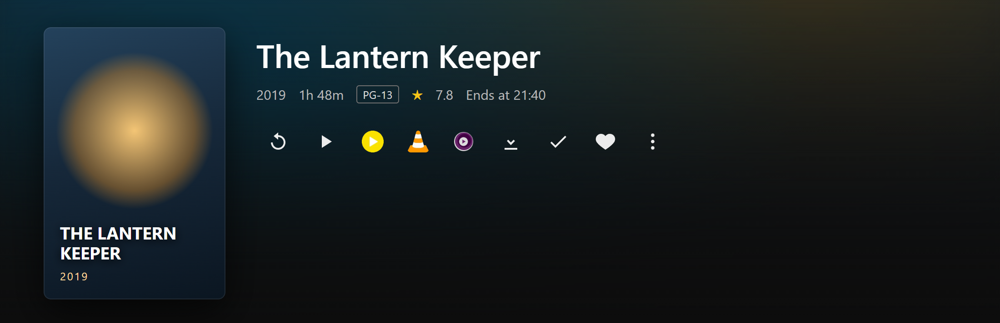

# Greasy Fork listing text

This file is the **canonical copy** of the text shown on the Greasy Fork script page.

Greasy Fork only imports the header keys from the script file. The long description
("Additional info") lives on the site and must be pasted in by hand — so it is versioned here
and kept in sync with `README.md`.

Paste the blocks below into the corresponding fields on
<https://greasyfork.org/scripts/…/edit>.

---

## Summary field

> Adds external player buttons (PotPlayer, VLC, IINA, nPlayer, Infuse, MX Player, mpv) to the
> Jellyfin item detail page. Plays the original file directly, without transcoding.

*(The summary is normally taken from `@description` in the script header — leave the field
alone unless it needs overriding.)*

## Additional info field

```markdown
Adds one button per available external player to the Jellyfin item detail page, right after the
native Play button. Clicking a button opens the original file in your own player — direct play,
no transcoding, no quality loss.



**Players:** PotPlayer, VLC, IINA, nPlayer, Infuse, MX Player, mpv.
Only the players available on your platform are shown — no IINA button on Windows, no PotPlayer
button on macOS.

**What it does**

- Direct play — the original file is streamed through Jellyfin
  (`/Videos/{id}/stream?static=true`), nothing is transcoded.
- Resume — the stored playback position is forwarded to the player where supported.
- Subtitles — the external subtitle track selected in Jellyfin is attached where the player
  supports it.
- Series and seasons — pressing the button on a show opens the next-up episode.

**Requirements**

- Jellyfin 10.8 or newer (uses the `ApiKey` query parameter). Tested on 12.4.
- Tampermonkey, Violentmonkey or another userscript manager.
- Desktop VLC and mpv need a `vlc://` / `mpv://` protocol handler installed first. On macOS,
  IINA works out of the box.

**Notes**

- The script makes no network requests of its own; player icons are embedded in the file.
- The stream URL contains your access token and is handed to your local player. Some players
  keep it in their "recent files" list.
- If your Jellyfin is not served under `/web/index.html` or on port 8096, add an `@include`
  line for your address.

Source, documentation and issue tracker:
<https://github.com/dncore/jellyfin-external-player>
```

## Screenshot URLs usable in the listing

Greasy Fork only accepts `https` images, so reference the raw GitHub files rather than the
relative paths used in `README.md`:

```
https://raw.githubusercontent.com/dncore/jellyfin-external-player/main/docs/screenshot-windows.png
https://raw.githubusercontent.com/dncore/jellyfin-external-player/main/docs/screenshot-macos.png
https://raw.githubusercontent.com/dncore/jellyfin-external-player/main/docs/screenshot-buttons.png
```
